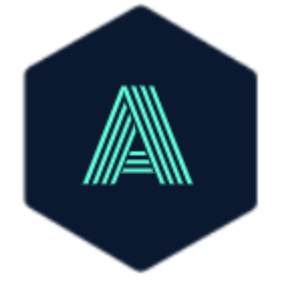

<div align="center">
  
</div>
<h1 align="center">
  Ayon Roy
</h1>
<p align="center">
  Personal Portfolio <a href="https://www.ayonroy.com/" target="_blank">ayonroy.com</a> built with <a href="https://nextjs.org/" target="_blank">Next.js</a> and deployed with <a href="https://www.netlify.com/" target="_blank">Netlify</a>
</p>

## 🛠 Tech Stack

- **Framework**: Next.js 14 (App Router, Static Export)
- **Styling**: Tailwind CSS, PostCSS
- **Icons**: Custom SVG icons & Lucide React
- **Typography**: Calibre & SF Mono
- **Deployment**: Netlify (`netlify.toml` with `out/` static publish)

## 🚀 Getting Started

1. **Install dependencies**:
   ```sh
   npm install
   ```

2. **Run local development server**:
   ```sh
   npm run dev
   ```
   Open [http://localhost:3000](http://localhost:3000) to view in the browser.

3. **Build for production**:
   ```sh
   npm run build
   ```
   This generates an optimized static export in the `out/` directory, ready to deploy.

## 🎨 Color Reference

| Color          | Hex        |
| -------------- | ---------- |
| Navy           | `#0a192f`  |
| Dark Navy      | `#020c1b`  |
| Light Navy     | `#172a45`  |
| Dark Grey      | `#333f58`  |
| Slate          | `#8892b0`  |
| Light Slate    | `#a8b2d1`  |
| Lightest Slate | `#ccd6f6`  |
| White          | `#e6f1ff`  |
| Teal / Green   | `#64ffda`  |
